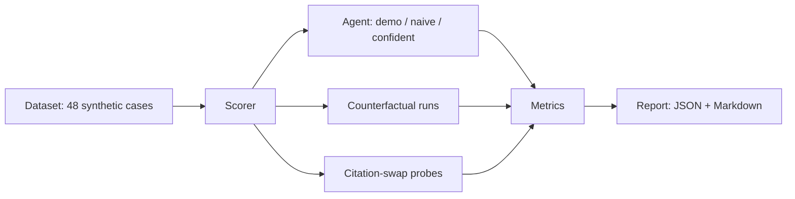

# Architecture

## 1. What this is

XAI-Health Bench scores a healthcare agent's **explanation**, not just
its answer. Accuracy benchmarks (MedQA, LLMEval-Med, FHIR-AgentBench)
check whether the answer is right; attribution benchmarks (BenchXAI)
check explanation methods, not LLM agents. This bench checks three
things together: does the explanation change when the evidence
changes (faithfulness), does every cited claim appear in its source
(citation grounding), and does the agent abstain when the evidence is
insufficient (abstention calibration).

## 2. Pipeline

1. **Dataset** (`xai_health_bench/dataset.py`): loads and validates
   `datasets/xai_health.jsonl`. One case = a question, 2–3 synthetic
   evidence passages, expected facts (each tied to one passage),
   distractor facts, an abstain flag, optional counterfactual
   perturbations, and optional citation-swap probes.
2. **Agents** (`xai_health_bench/agents.py`): three deterministic,
   standard-library agents sharing one interface. The demo agent is
   selective answering (BM25 retrieval → lexical verification →
   evidence-strength abstention gate → composition from verified
   claims). The naive agent is an extractive baseline. The confident
   agent is a synthetic hallucinating agent that exists only to
   validate that the bench catches hallucinations.
3. **Metrics** (`xai_health_bench/metrics.py`): lexical, deterministic
   scores — see `docs/metrics.md`.
4. **Scorer** (`xai_health_bench/scorer.py`): runs every case
   unperturbed, then re-runs every counterfactual perturbation and
   every swap probe, and aggregates. Swap sensitivity is reported
   separately and is not part of `bench_score`.
5. **Report** (`xai_health_bench/report.py`): JSON + Markdown, plus a
   per-agent comparison table.

## 3. Eval-platform plug-in

`xai_health_bench/adapters/eval_platform.py` wraps the demo agent in
the ai-evaluation-platform's `AgentAdapter` contract, and
`scripts/export_eval_platform_dataset.py` exports the dataset in that
platform's format. The bench's own metrics travel in the adapter's
`structured` field. No change to the eval platform's core is needed.

## 4. Design decisions

- **Lexical, not semantic.** Every check is token overlap, number
  matching, or phrase presence. A lexical bench can miss a correct
  paraphrase; that limitation is documented in every place the
  numbers appear, and it is the same trade-off the
  ai-evaluation-platform makes.
- **Synthetic evidence only.** All passages are hand-written, clearly
  labelled, and fictional. No real patient data, no real studies, no
  real medical guidance. The dataset builder enforces the "Synthetic
  summary" title prefix and checks passage/question alignment.
- **Deterministic.** No LLM, no embeddings, no network, no randomness.
  The same command produces the same numbers (the notebooks assert
  the ranking, not just print it).
- **The demo agent is the reference implementation.** It scores 1.000
  on its own bench. That is a ceiling check — proof the bench is
  solvable by a careful agent — not evidence about real-world
  performance. The bench's discriminating power is shown by the
  baselines: naive 0.975, confident 0.905 — and by swap sensitivity,
  the one metric that separates the agents on its own (demo 1.000,
  naive 0.000, confident 0.000).
